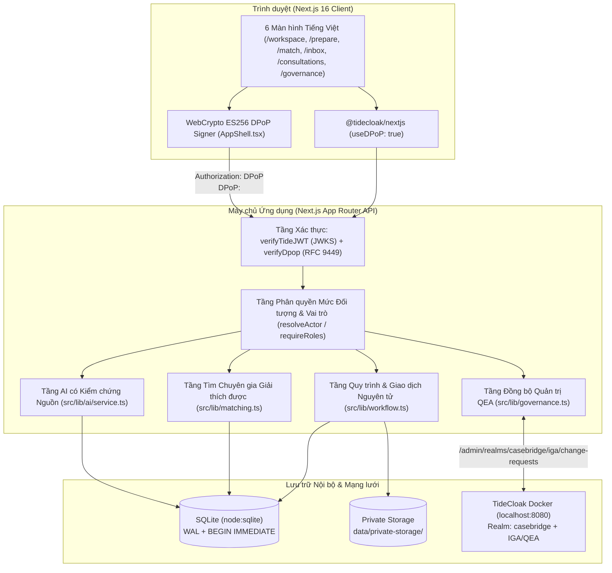

# Kiến trúc Hệ thống & Ranh giới Tin cậy — CaseBridge

## 1. Sơ đồ Thành phần Hệ thống

---

## 2. Phân tách Quyền hạn & Nơi Thực thi từng Quyền (Section 9)

CaseBridge thực thi nguyên tắc **không tin tưởng đầu vào từ phía máy khách** (Zero Client-Trust) ở mọi tuyến API:

### 2.1. Xác thực danh tính & Chống đánh cắp Token (`src/lib/auth/tideJWT.ts` & `src/lib/auth/verifyDpop.ts`)
- Mọi yêu cầu tới `/api/*` đi qua `resolveActor(req)` trong [`src/lib/auth/session.ts`](file:///Users/truongledanchi/Downloads/rmithack/src/lib/auth/session.ts).
- **Xác thực chữ ký JWT:** Kiểm tra chữ ký số qua bộ khóa công khai JWKS cục bộ (`data/tidecloak.json`), kiểm tra hạn `exp`, `iss`, và `azp`.
- **Xác thực RFC 9449 DPoP (`verifyDpop`):**
  - Bắt buộc lược đồ `Authorization: DPoP <access_token>` đi kèm tiêu đề `DPoP: <proof_jwt>`.
  - Kiểm tra khớp dấu vân tay khóa công khai `cnf.jkt` trong access token với JWK trong tiêu đề DPoP proof.
  - Kiểm tra khớp phương thức HTTP (`htm`), đường dẫn tuyệt đối (`htu`), băm SHA-256 của access token (`ath`), cửa sổ thời gian `iat` (`±300s`), và bộ nhớ chống phát lại `jti` (Replay Cache).
  - Nếu một access token gắn `cnf.jkt` bị đánh cắp và gửi lại dưới dạng `Authorization: Bearer <token>`, máy chủ lập tức trả về `401 Unauthorized` (`A10`).

### 2.2. Nguồn gốc Tổ chức & Vai trò từ Máy chủ (`A01`, `A10`)
- `organization_id` và `role` của người thao tác luôn được tra cứu từ bảng `users` trên máy chủ theo `sub` đã xác thực; mọi trường `organization_id` do client gửi trong body khi tạo ca (`POST /api/cases`) đều bị bỏ qua (`A01`).

### 2.3. Ma trận Phân quyền Mức Đối tượng (Object-Level Authorization)

| Đối tượng / Thao tác | `referring_clinician` (BS gửi) | `consulting_specialist` (Chuyên gia) | `coordinator` (Điều phối viên) | `network_admin` (Quản trị QEA) |
| :--- | :--- | :--- | :--- | :--- |
| **Đọc chi tiết ca bệnh & Tài liệu gốc** (`/api/cases/[id]`, `/api/documents/[id]`) | Chỉ đọc được ca thuộc **cùng `organization_id`** (`403` nếu khác cơ sở) | Chỉ đọc được **sau khi đã `ACCEPT` lời mời** của ca đó và còn quyền `network_consultant` (`403` trước khi nhận ca) | **Bị che toàn bộ dữ liệu lâm sàng** (`clinical_payload_redacted: true`), chỉ thấy trạng thái điều phối & `403` khi tải file gốc | **`403 Forbidden`** — Không được xem dữ liệu lâm sàng (`Section 9.3`) |
| **Chạy AI chuẩn bị & Chốt `ReferralSnapshot`** | Chỉ cho ca thuộc cơ sở mình; bắt buộc `confirmed_by_clinician === true` và khớp `input_version` | `403 Forbidden` | `403 Forbidden` | `403 Forbidden` |
| **Lưu `ClinicalAssessment`, Duyệt `TestSuggestion`, Chốt `TestPlanVersion`, Tạo `MockTestOrder`** (`A20`) | Chỉ bác sĩ tuyến dưới thuộc cơ sở quản lý ca bệnh | `403 Forbidden` | `403 Forbidden` | `403 Forbidden` |
| **Nhận / Từ chối lời mời hội chẩn** (`/api/invitations/[id]/accept`) | `403 Forbidden` | Chỉ đúng chuyên gia được mời + còn hạn + có quyền QEA `network_consultant` | `403 Forbidden` | `403 Forbidden` |
| **Gửi yêu cầu bổ sung thông tin & Phản hồi chuyên môn** | Phản hồi yêu cầu bổ sung (tạo `ReferralSnapshot` mới) | Chỉ chuyên gia đã nhận ca | `403 Forbidden` | `403 Forbidden` |
| **Quản trị mạng lưới & Đề xuất QEA** (`/api/governance/changes`) | Chỉ đọc trạng thái minh bạch | Chỉ đọc trạng thái minh bạch | Chỉ đọc trạng thái minh bạch | Tạo đề xuất thay đổi quyền (nhưng **không tự nâng quyền** nếu chưa đủ quorum QEA) |

---

## 3. Tách biệt Quản trị Tide QEA khỏi Luồng Hồ sơ Hàng ngày (Section 9.2 & 12)

CaseBridge phân định rõ:
1. **Quản trị cấu trúc mạng lưới (Tide QEA — Quorum-Enforced Authorization):**
   - Áp dụng cho các thay đổi nhạy cảm cấp mạng lưới, trọng tâm là việc cấp/thu hồi vai trò **`network_consultant`** (quyền tham gia danh sách chuyên gia nhận hội chẩn liên cơ sở).
   - Công thức ngưỡng đồng thuận: `required_approvals = max(1, floor(0.7 * N))` với `N` là số quản trị viên độc lập đang hoạt động (`tide-realm-admin`). Với `N = 3` quản trị viên trong mạng lưới demo, hệ thống yêu cầu tối thiểu **`2` chữ ký phê duyệt độc lập** trước khi lệnh `GRANT_ROLES` có thể commit.
   - Bảng `governance_links` trong SQLite chỉ đóng vai trò **bản ghi tham chiếu & hiển thị trạng thái** từ `/admin/realms/casebridge/iga/change-requests` của TideCloak; việc tạo một bản ghi `PENDING` trong ứng dụng tuyệt đối không tự thêm `network_consultant` vào `users.tide_roles_json` (`A11`).
2. **Vận hành ca bệnh hàng ngày (Application Workflow):**
   - Các thao tác tạo ca, chạy AI tóm tắt, lưu nhận định lâm sàng, duyệt gợi ý xét nghiệm, gửi lời mời, nhận ca và phản hồi hội chẩn được kiểm soát bởi bộ máy trạng thái (`src/lib/workflow.ts`) và khóa giao dịch SQLite (`BEGIN IMMEDIATE TRANSACTION`), đảm bảo tốc độ tức thì cho bác sĩ lâm sàng mà không cần gọi hội đồng admin trên từng ca bệnh.
